# Deep Learning – Lab 1: MLPs with PyTorch (Regression and Multi-class Classification)

**Université Abdelmalek Essaadi – FSTT – Département Génie Informatique – Master MBD**
**Course:** Deep Learning – Pr. Elaachak Lotfi
**Student:** Soukaina Zahti

---

## 1. Objective

Get familiar with PyTorch by building DNN/MLP architectures for:

1. a **regression** task: predict the next-day closing price of NYSE stocks;
2. a **multi-class classification** task: predict the failure type of a machine (Machine Predictive Maintenance dataset).

For each task: EDA, preprocessing, MLP in PyTorch, hyper-parameter search with scikit-learn `GridSearchCV`, Loss/Epochs and Accuracy/Epochs curves, regularization and comparison with the first model.

## 2. Environment and reproducibility

- Google Colab, **CPU runtime** (no GPU used), Python 3, PyTorch, scikit-learn, skorch (PyTorch ↔ scikit-learn bridge), imbalanced-learn, pandas, seaborn.
- Global seed = 42. Datasets are downloaded with `kagglehub` (`dgawlik/nyse`, `shivamb/machine-predictive-maintenance-classification`).
- Everything is in `lab1.ipynb` (Runtime → Run all).
- All results below come from **one run with one seed and one split**. Small differences between models should be read with that in mind.

## 3. Shared code

- **`MLP` class**: `Linear → (BatchNorm) → ReLU → (Dropout)` repeated `n_layers` times, then a final `Linear` with no activation (a number for regression, logits for classification).
- **`fit` / `run_epoch`**: our own training loop (forward → loss → `zero_grad` → `backward` → `step`) that records train and test loss and score at every epoch, and supports early stopping on a separate validation set.
- **Score used in the "Accuracy / Epochs" graph:** accuracy for classification. Accuracy is not defined for regression, so **R² is used as the accuracy-like score** in Part 1.
- **GridSearch:** `GridSearchCV` + `skorch` wrapper, 5 hyper-parameters, 2 values each (32 combinations × 3 folds = 96 fits): learning rate {1e-3, 1e-2}, optimizer {Adam, SGD}, epochs {20, 40}, hidden units {32, 64}, hidden layers {2, 3}.

---

## 4. Part 1 – Regression (NYSE)

### 4.1 Data and EDA

`prices-split-adjusted.csv`: **851,264 rows × 7 columns** (date, symbol, open, close, low, high, volume), **501 stocks**, 2010-01-04 → 2016-12-30. **No missing values, no duplicates.**

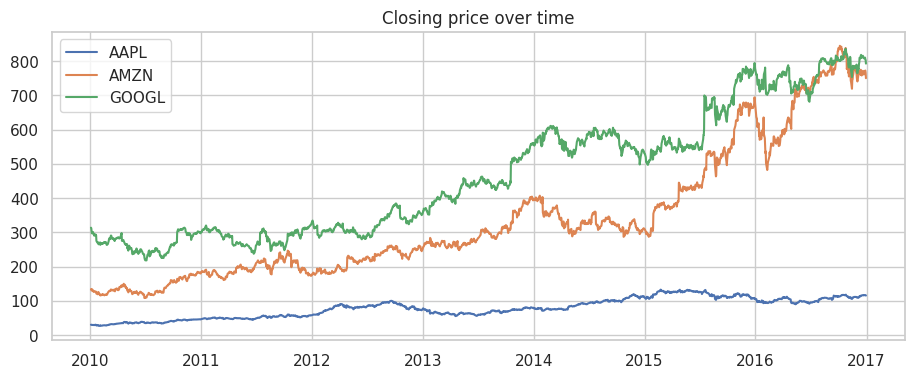
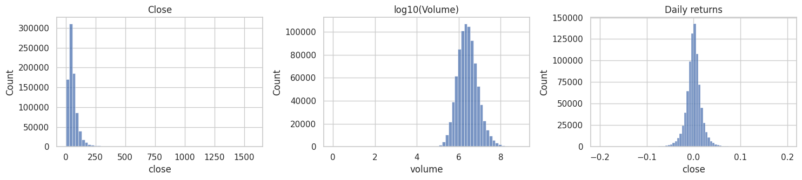
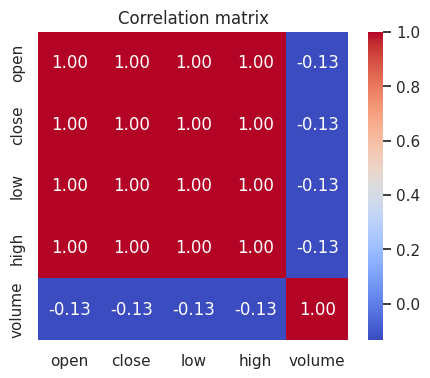

Observations:

- Prices span a very wide range (min $1.59, median ≈ $48, max ≈ $1,578), so **standardization is required** before feeding a neural network.
- Prices follow trends that differ a lot from one stock to another (AAPL ≈ $30–$130, GOOGL and AMZN above $700 by 2016): the test period contains price levels that are higher than most of the training period.
- Volume is strongly right-skewed (mean 5.4M, max 860M); on a log10 scale it is roughly bell-shaped. Daily returns are centred on 0 with fat tails.
- `open`, `close`, `low`, `high` are almost perfectly correlated (≈ 1.00); volume is slightly negatively correlated with prices (−0.13).

### 4.2 Problem definition and preprocessing

- **Task:** predict the **next-day close** from today's information. Predicting today's close from today's open/high/low would be almost trivial.
- **Data used:** 20 randomly chosen stocks (to keep GridSearch fast). Features (8): open, high, low, close, volume, 1-day return, 5-day and 10-day moving averages.
- **Split:** chronological, **train = before 2016 (27,770 rows), test = 2016 (5,020 rows)**. No shuffling, to avoid leaking the future into training.
- **Scaling:** `StandardScaler` fitted on the training set only (features and target). Metrics are converted back to dollars.
- **Naive reference ("tomorrow = today")** on the test set: **RMSE = 1.663 $, R² = 0.9992.**

### 4.3 Model 1 – baseline MLP and GridSearch

`GridSearchCV` with `TimeSeriesSplit(3)`, scoring = negative MSE.

**Best hyper-parameters:** Adam, learning rate 1e-3, 40 epochs, 2 hidden layers of 32 neurons (best CV MSE on the scaled target = 0.00096).

| Set | RMSE ($) | MAE ($) | R² |
|---|---|---|---|
| Train | 1.277 | 0.814 | 0.99920 |
| Test | 1.768 | 1.055 | 0.99908 |

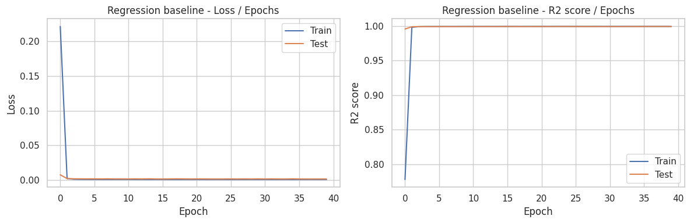

**Interpretation.** Loss falls from 0.22 to almost 0 within the first two epochs and then stays flat; R² goes from 0.78 (first epoch, train) to ≈ 1.0 and both curves overlap for the remaining 38 epochs. There is no divergence between train and test, so **no overfitting and no underfitting**. The small final gap (RMSE 1.28 vs 1.77 dollars) is expected because the test year has higher price levels than the training years. The problem is easy for the network because tomorrow's close is very close to today's close and the moving averages.

An important honest point: the MLP (test RMSE 1.768) does **not beat** the naive "tomorrow = today" reference (RMSE 1.663). Stock prices behave close to a random walk, so the network mostly learns to copy the last price.

### 4.4 Model 2 – regularization

Techniques combined: **Dropout (0.2)**, **Batch Normalization**, **L2 weight decay via AdamW (1e-3)** and **early stopping** (patience 10 on a validation set made of the last 10 % of the training period). The network was also widened to 64 neurons per layer (2 layers) to compensate for dropout. Training stopped at epoch 20.

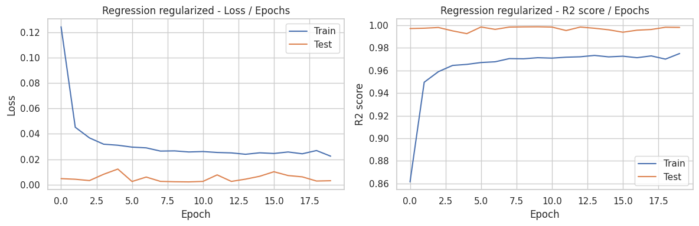

| Model | Set | RMSE ($) | MAE ($) | R² |
|---|---|---|---|---|
| Baseline | Train | 1.277 | 0.814 | 0.99920 |
| Baseline | Test | **1.768** | **1.055** | **0.99908** |
| Regularized | Train | 1.622 | 1.132 | 0.99871 |
| Regularized | Test | 2.071 | 1.359 | 0.99873 |

**Comparison.** The regularized model is **slightly worse** on the test set (RMSE +17 %, MAE +29 %), while the train–test RMSE gap barely changes (0.49 → 0.45). The train curve is below the test curve because dropout is active during training and not during testing. The test curve is also noisier from one epoch to the next. This is a coherent result: the baseline model was not overfitting, so there was nothing for regularization to fix, and it only removed some capacity. **Conclusion: for this task the baseline MLP is the better model, and neither network is better than the naive reference.**

---

## 5. Part 2 – Multi-class classification (Predictive Maintenance)

### 5.1 Cleaning, preprocessing and feature engineering

- Raw data: **10,000 rows**, 10 columns, no missing values, no duplicates.
- **Inconsistent labels removed (27 rows):** 9 rows with `Target = 1` but "No Failure", and all 18 "Random Failures" rows (random events with no signal in the sensors that cannot be predicted; they are also too few to learn). **9,973 rows and 5 classes remain.**
- **Columns dropped:** `UDI` and `Product_ID` (identifiers), `Target` (it is the label "failure yes/no", i.e. data leakage).
- **Encoding:** `Type` L/M/H → 0/1/2; the failure type is label-encoded.
- **Engineered features:** `Temp_diff` = process temp − air temp, `Power` = torque × rotation speed × 2π/60, `Strain` = tool wear × torque.
- **Split:** stratified 80/20 → **7,978 train / 1,995 test**. **Standardization** with `StandardScaler` fitted on the training set only.

### 5.2 EDA

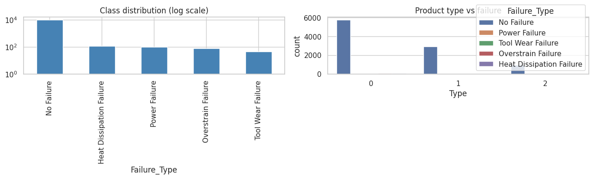
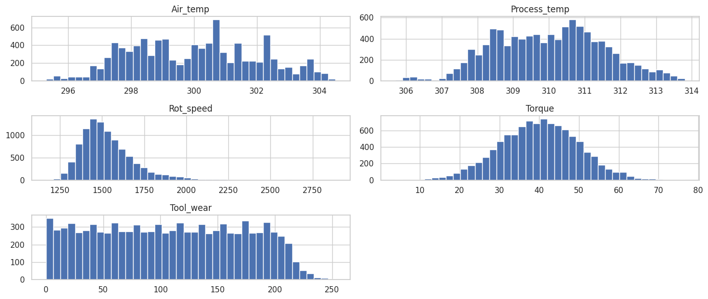
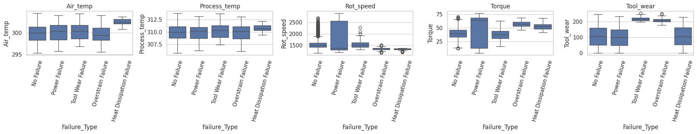
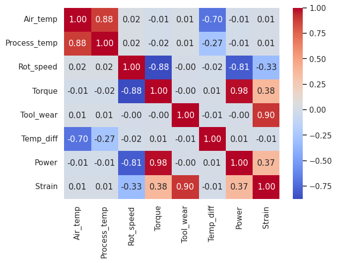

- **Extreme class imbalance:** 9,652 "No Failure" (≈ 97 %) versus 112 Heat Dissipation, 95 Power, 78 Overstrain and 45 Tool Wear failures (before the split).
- Air and process temperature are strongly correlated (0.88); rotation speed and torque are strongly negatively correlated (−0.88). The engineered features are partly redundant with their parents (Power–Torque 0.98, Strain–Tool_wear 0.90), but they expose the physics of each failure mode.
- Each failure type has its own signature: Tool Wear and Overstrain occur at high tool wear; Overstrain and Heat Dissipation at low rotation speed and high torque; Heat Dissipation at high air temperature; Power failures show a very wide spread of speed and torque.
- Most machines are of type L (0), followed by M and H; failures are rare in every type.

### 5.3 Data augmentation (SMOTE)

Applied **only to the training set, after the split and the scaling**, so that no synthetic sample derived from test data leaks into training. SMOTE creates a new minority sample on the line between a real sample and one of its nearest minority neighbours.

| Class | Train before SMOTE | Train after SMOTE |
|---|---|---|
| Heat Dissipation Failure | 90 | 7,714 |
| No Failure | 7,714 | 7,714 |
| Overstrain Failure | 62 | 7,714 |
| Power Failure | 76 | 7,714 |
| Tool Wear Failure | 36 | 7,714 |

The **test set is left imbalanced** (22 / 1,929 / 16 / 19 / 9 samples) because this is the real-world distribution.

### 5.4 Model 1 – baseline MLP and GridSearch

`GridSearchCV` (stratified 3-fold) on an `imblearn` pipeline **SMOTE → MLP**, so that SMOTE is applied only to the training part of each fold. Scoring = **macro-F1** (plain accuracy would reward a model that always predicts "No Failure", ≈ 97 %).

**Best hyper-parameters:** Adam, learning rate 1e-3, 40 epochs, **3 hidden layers of 64 neurons**. Best CV macro-F1 = 0.425 (lower than the final test macro-F1 because each fold contains only ⅔ of the already tiny minority classes, so SMOTE has even fewer real points to interpolate from).

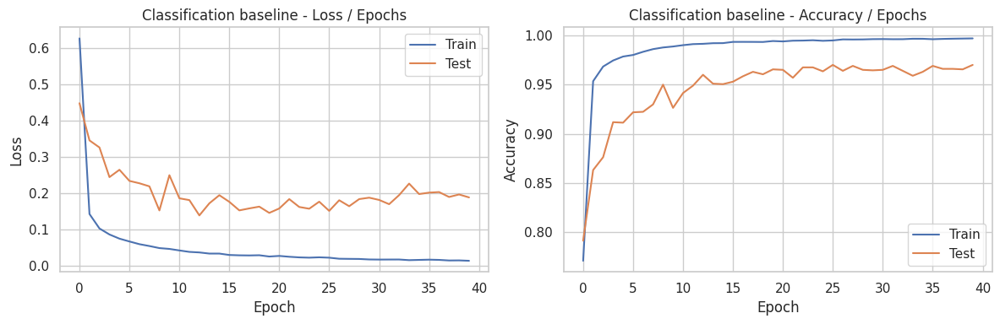

**Interpretation.** Train loss decreases steadily (0.63 → 0.015) and train accuracy reaches ≈ 99.7 %. Test loss decreases quickly, reaches its minimum around epoch 12–20 (≈ 0.14–0.15) and then **rises slowly and oscillates around 0.19–0.20**, while test accuracy plateaus at ≈ 0.96–0.97 with visible fluctuations. This is a **mild overfitting** pattern: the network becomes more and more confident on the training data (including the synthetic samples) without improving on unseen data. The two accuracy levels are not directly comparable: train accuracy is measured on the balanced, augmented set, test accuracy on the imbalanced real set. The fluctuations are explained by tiny test classes, where a single sample changes the score.

### 5.5 Metrics (train and test, original non-augmented data)

| Metric | Train | Test |
|---|---|---|
| Accuracy | 0.989 | 0.970 |
| Sensitivity (macro recall) | 0.991 | 0.766 |
| Precision (macro) | 0.811 | 0.637 |
| F1 (macro) | 0.873 | 0.682 |
| F1 (weighted) | 0.991 | 0.974 |

Per-class results on the test set:

| Class | Precision | Recall | F1 | Support |
|---|---|---|---|---|
| Heat Dissipation Failure | 0.75 | 0.82 | 0.78 | 22 |
| No Failure | 0.99 | 0.98 | 0.98 | 1,929 |
| Overstrain Failure | 0.67 | 0.75 | 0.71 | 16 |
| Power Failure | 0.64 | 0.84 | 0.73 | 19 |
| Tool Wear Failure | 0.14 | 0.44 | 0.21 | 9 |

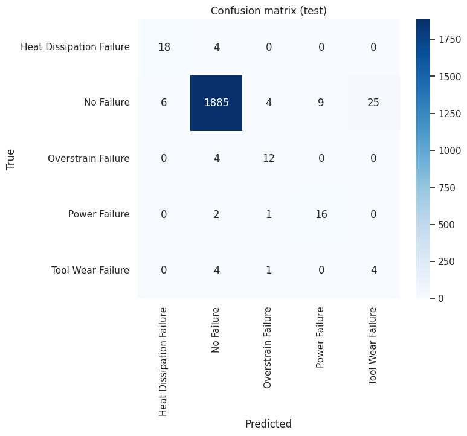

**Interpretation.** Accuracy (0.97) is high mostly because of the "No Failure" class, which is why macro scores (0.64 precision, 0.77 recall, 0.68 F1) are the honest summary. The model catches most failures (recall 0.75–0.84 for the three well-represented failure types) but produces false alarms. The weakest class is **Tool Wear**: only 4 of 9 real cases are found, and 25 healthy machines are predicted as Tool Wear (precision 0.14). 44 of the 1,929 healthy machines are wrongly flagged in total (≈ 2.3 %). Tool Wear is hard because it has the fewest real samples (36 in training) and its sensor signature (high tool wear) overlaps with Overstrain and with many normal machines.

### 5.6 Model 2 – regularization

Dropout (0.3), Batch Normalization, AdamW with weight decay 1e-3, early stopping (patience 10 on a validation split taken from the training set), and a wider network (3 layers × 128 neurons). Early stopping triggered at epoch 85.

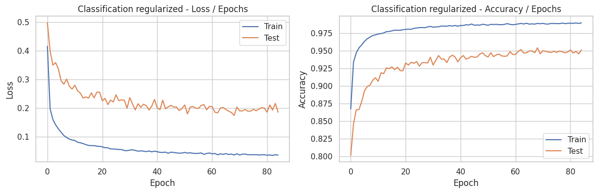

| Model | Set | Accuracy | Sensitivity (macro recall) | Precision (macro) | F1 (macro) |
|---|---|---|---|---|---|
| Baseline | Train | 0.989 | 0.991 | 0.811 | 0.873 |
| Baseline | Test | **0.970** | 0.766 | **0.637** | **0.682** |
| Regularized | Train | 0.969 | 0.994 | 0.703 | 0.780 |
| Regularized | Test | 0.949 | **0.823** | 0.604 | 0.672 |

**Comparison.**

- **Smoother learning curves:** with regularization, train and test loss decrease steadily and no longer show the test-loss rise seen in the baseline. However, the best test loss reached (≈ 0.175) is not lower than the baseline's best (≈ 0.14).
- **Smaller train–test gap on F1:** the macro-F1 gap shrinks from 0.19 to 0.11, so the model memorizes the training set less.
- **Higher sensitivity:** test macro recall improves from 0.766 to **0.823** (+5.7 points), i.e. more real failures are caught.
- **But more false alarms:** test precision drops (0.637 → 0.604) and accuracy drops by 2 points (0.970 → 0.949); macro-F1 is practically unchanged (0.682 → 0.672, a difference that is within the noise given 9–22 test samples per minority class).

**Conclusion.** Regularization did not improve the overall score, but it changed the trade-off: the regularized model detects more failures at the price of more false alarms. In predictive maintenance, a missed failure usually costs more than an unnecessary inspection, so the regularized model can be preferred if recall is the priority; the baseline is preferable if false alarms are costly. The main limit is the data (36 to 90 real examples per failure type), not the capacity of the network.

---

## 6. Limitations

- **Regression:** only 20 stocks, one chronological split; stock prices are close to a random walk, and the naive "tomorrow = today" reference is as good as or better than the MLP.
- **Classification:** very few real minority samples; SMOTE interpolates between them, can overfit to these few points, and produces fractional values for the categorical `Type` feature (`SMOTENC` would handle it properly). Test scores for classes with 9–22 samples are noisy.
- **Early stopping validation set (Part 2)** is taken from the SMOTE-augmented training data, so it contains synthetic neighbours of training samples; this probably explains why early stopping only triggered at epoch 85. A cleaner design would split before SMOTE.
- Single seed, single run, small GridSearch grid (32 combinations); the "Random Failures" class was removed because it cannot be predicted from sensor values.

## 7. Personal synthesis – what I learned

In this lab I learned how to build a complete PyTorch workflow: tensors and `DataLoader`s, a configurable MLP class, the training and evaluation loop (forward, loss, backward, optimizer step), and how the Loss/Epochs and Accuracy/Epochs curves reveal under-fitting and over-fitting. I also learned how to tune hyper-parameters with scikit-learn's `GridSearchCV` through `skorch`, and why the cross-validation must respect the data: a time-ordered split for stock prices, and SMOTE applied inside each fold for the imbalanced classification.

The most important lessons came from the results, not from the code. First, preprocessing choices matter as much as the model: scaling with training statistics only, splitting before augmenting, and removing the `Target` column that leaks the label. Second, the metric must fit the problem: in the classification task 97 % accuracy hides a macro-F1 of 0.68 and a Tool Wear precision of 0.14, so macro-F1 and sensitivity are more informative. Third, a comparison with a naive reference is essential: my regression MLP reached R² = 0.999, but the simple "tomorrow = today" rule was as good, so a good-looking score does not prove that the model learned something useful. Finally, regularization is not a magic fix: it did nothing useful for the regression model, which was not overfitting, and in the classification task it traded precision for sensitivity instead of improving everything. It reduces memorization, but it cannot create information that the data does not contain.

## 8. Repository content

```
├── lab1.ipynb                    # full code, outputs and plots
├── README.md                     # this report
├── Regression_baseline.png       # Loss/Epochs and R²/Epochs, model 1
├── Regression_regularized.png    # same, regularized model
├── Classification_baseline.png   # Loss/Epochs and Accuracy/Epochs, model 1
├── Classification_regularized.png
├── confusion_matrix.png
└── eda_*.png                     # EDA figures for both datasets
```
